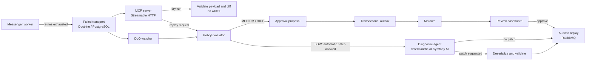

# DLQ Doctor

**Turn a dead-letter queue into an actionable, human-supervised recovery workflow.** Built for the [Symfony Hackathon](https://symfony.com/hackathon), DLQ Doctor combines Messenger, MCP, Symfony AI, policy enforcement and live Mercure updates to diagnose failures without giving an AI agent authority to replay messages.

## Architecture



The watcher can process failures without MCP. MCP dry-runs do not invoke the agent or replay a message; replay requests and watcher processing use the same policy-driven service. The default agent is deterministic and offline; Symfony AI is optional. A proposal is not a replay, and the dashboard does not apply the dry-run payload.

## Local demo

### Quickstart: three commands

Prerequisites: Docker Engine, Docker Compose v2, GNU Make, Bash, and an available host port 80 (or configure another port as shown below). On Linux, `xdg-open` opens the dashboard; otherwise use the link below. Start from the repository root:

```bash
read -rs -p 'Disposable local demo password: ' DLQ_DEMO_PASSWORD && printf '\n' && export DLQ_DEMO_PASSWORD && make rebuild && make fixtures && unset DLQ_DEMO_PASSWORD
make chaos && sleep 10 && make watch
xdg-open http://localhost/
```

The first command builds and starts the stack, applies migrations and loads the dev-only `demo` operator without purging data. Sign in with `demo` and the password entered above. The second injects four failures, waits for retries, then explicitly runs the watcher once. The third opens the [dashboard](http://localhost/). On a slow system, retries can take longer than ten seconds: check the worker logs and run `make watch` again once all failures have arrived.

No host PHP, tenant header, tenant environment variable, or AI API key is required. Compose builds the app and CLI worker, and starts PostgreSQL, RabbitMQ, the Messenger worker, and the outbox publisher. `make help` lists the available shortcuts.

Expected batch: one LOW automatic patch-and-replay, audited with the changed property names, and three approval proposals (MEDIUM, HIGH, and unclassified, which defaults to HIGH). The LOW message succeeds on the worker after its invalid status is restored to the explicit contract default; proposal-required messages remain in the failure transport until reviewed. HIGH deletion is forbidden by policy. Re-run `app:chaos:inject` to add another set of scenarios.

The local demo uses deterministic diagnosis by default (`APP_DEMO_DETERMINISTIC=true`), so no paid model API is used. Optional external diagnosis supports OpenAI, Anthropic Claude, and Google Gemini; see [AI provider configuration](docs/ai-agent.md#external-providers). AI output is a suggestion, not authorization to replay, patch, or discard a message.

### Quickstart with a real API key

Use the same prerequisites as above, plus an OpenAI API key with access to `gpt-4o-mini` and sufficient quota. This example prompts for your own key without storing it in shell history or a project file:

```bash
read -rs -p 'OpenAI API key: ' OPENAI_API_KEY && printf '\n'
export OPENAI_API_KEY
export APP_DEMO_DETERMINISTIC=false DLQ_AI_PROVIDER=openai DLQ_AI_MODEL=gpt-4o-mini
read -rs -p 'Disposable local demo password: ' DLQ_DEMO_PASSWORD && printf '\n'
export DLQ_DEMO_PASSWORD
make rebuild && make fixtures
make chaos && sleep 10 && make watch
xdg-open http://localhost/
```

Sign in with `demo` and the password entered above. If that account already exists, use its existing password; fixtures do not overwrite it. On a slow system, wait for retries to finish and run `make watch` again.

The watcher invokes the external model for the patch-eligible LOW scenario. MEDIUM and HIGH remain approval-gated. Unlike the deterministic quickstart, the model's patch is not guaranteed: invalid output, provider errors or exhausted quota fail explicitly, and an unchanged LOW payload may fail again after replay. Inspect `make logs SERVICE=app` and `make logs SERVICE=worker` if needed.

**This makes real API requests and may incur charges.** The synthetic payload and schema are sent to OpenAI. Never use confidential messages without reviewing the [data-handling notes in ai-agent.md](docs/ai-agent.md#data-handling), and never commit your key. Claude and Gemini equivalents are documented in [ai-agent.md](docs/ai-agent.md#external-providers).

Keep the exported variables available for subsequent Compose commands that recreate containers. When finished, stop the stack before clearing them:

```bash
make down
unset OPENAI_API_KEY DLQ_DEMO_PASSWORD APP_DEMO_DETERMINISTIC DLQ_AI_PROVIDER DLQ_AI_MODEL
```

### Review the proposals

The UI and MCP endpoints remain protected. To set up the **dev-only** global `demo` operator separately, choose a throwaway password in Bash and load the fixture explicitly:

```bash
read -rs -p 'Local demo password: ' DLQ_DEMO_PASSWORD; printf '\n'
export DLQ_DEMO_PASSWORD
docker compose up -d --build --wait app
docker compose exec app php bin/console doctrine:fixtures:load --group=dlq-demo --append --no-interaction
unset DLQ_DEMO_PASSWORD
```

Keep `--append`: without it, Doctrine Fixtures can purge existing data. Re-running the command with the same password does not create another account or overwrite an existing one. The database stores only the password hash.

Open [http://localhost/](http://localhost/) and sign in. The development form shows `demo` and the configured demo password as placeholders, so **only use a disposable password and keep the development app local**. These hints and the demo account are disabled outside `dev`. The same account can authenticate a local MCP client with HTTP Basic; a browser session does not authenticate MCP requests.

Review the MEDIUM, HIGH, or unclassified proposal. Approve or reject a proposal; the original failure is replayed only after approval. Keep the page open while injecting and scanning another set to see private Mercure updates.

Patch dry runs validate a proposed payload and report a diff; the current UI does not submit or apply a patched payload. The configured LOW-risk policy also permits an agent-suggested patch to be applied automatically only after deserialization into the original message class and Symfony validation; the replay and changed property names are audited. MEDIUM and HIGH cases remain approval-gated.

### Ports, configuration, and troubleshooting

- The app is published on loopback at port 80 by default. If that port is in use, export both values before Compose:

  ```sh
  export APP_HTTP_PORT=18086
  export MERCURE_PUBLIC_URL=http://localhost:18086/.well-known/mercure
  docker compose up -d --wait
  ```

- In development, opening the login or proposal pages on `127.0.0.1` redirects to the configured Mercure host (`localhost` by default), because private Mercure cookies are host-specific. Existing sessions on the other host require signing in again. The app and `MERCURE_PUBLIC_URL` must use the same local port.
- PostgreSQL and RabbitMQ are reachable by service name from the Compose network and are not published to the host by default.
- For startup or migration problems, inspect `docker compose ps -a` and `docker compose logs migrate app`.
- For retries and DLQ transitions, inspect `docker compose logs worker`; run `app:dlq:watch --once` only after retry delivery has finished.
- For live updates, inspect `docker compose logs outbox-publisher app`. The publisher and browser share the configured Mercure cookie name.
- After source or Dockerfile changes, rebuild with `docker compose up -d --build --wait`.

Stop the stack without deleting persistent data with `docker compose down`. The database and embedded Mercure data use named volumes. Do not use `docker compose down -v` unless you intentionally want to erase them; DLQ records, proposals, and audit records do not have automatic cleanup.

### Makefile shortcuts

Run `make help` to list the available commands. They use `compose.yaml` plus `compose.override.yaml` by default; pass `MODE=dev` to use the standalone `compose.dev.yaml` instead, which bind-mounts the working tree into the app and workers. Both modes use the same Compose project and named volumes by default: switching modes can recreate containers and leave services absent from the selected file (such as the default mode's mailer) as orphans. The dev bind mount also requires host dependencies in `vendor/`; the migration service still uses the built image. Rebuild images after dependency or migration changes.

```sh
make up                              # start and wait for services
make build                           # build images without starting services
make rebuild                         # rebuild all images and restart the stack
make ps                              # inspect service status
make logs SERVICE=worker             # follow a single service's logs
make stop                            # stop services without removing containers
make start                           # start stopped services
make restart SERVICE=worker          # restart one service
make shell                           # open a shell in the app container
make migrate                         # apply database migrations
make fixtures                        # load the configured demo user without purging
make chaos                           # queue the demo messages
sleep 10 && make watch               # process a single DLQ batch
make watch-loop                      # or watch continuously until interrupted
make console ARGS="debug:router"     # run a Symfony console command
make test ARGS="tests/Unit"          # run a focused PHPUnit selection
make config                          # validate the selected Compose configuration
make down                            # remove containers and network, not volumes
```

For the bind-mounted setup, use the same mode for every command, for example `make MODE=dev up` and `make MODE=dev watch`. To load the demo operator, configure `DLQ_DEMO_PASSWORD` and restart the app as in the steps above, then run `make fixtures`; it always uses `--append`. `make test` uses `APP_ENV=test` and requires the separate test database and migrations to have been prepared. Compose environment variables such as `APP_HTTP_PORT` and `MERCURE_PUBLIC_URL` still apply.

## MCP tools

The application exposes Streamable HTTP at `http://localhost/mcp`, not STDIO. A client must initialize an MCP session before sending `tools/call` and include the session ID in subsequent requests. In development use HTTP Basic with the `demo` account; the web login session is separate. List failures with `dlq_list_failures` first and inspect a message's contract with `dlq_inspect_contract`. IDs and payloads below are illustrative and must match a failure in the caller's scope.

### Dry-run a patch

For a MEDIUM demo message whose original payload has `attempts: 4` and the reference shown below:

```json
{
  "jsonrpc": "2.0",
  "id": 2,
  "method": "tools/call",
  "params": {
    "name": "dlq_dry_run_patch",
    "arguments": {
      "messageId": "1",
      "proposedPayload": {"reference": "chaos-medium-f6d7b051a61d", "attempts": 0}
    }
  }
}
```

Response:

```json
{
  "jsonrpc": "2.0",
  "id": 2,
  "result": {
    "content": [{"type": "text", "text": "{\n    \"messageId\": \"1\",\n    \"messageClass\": \"App\\\\DlqDoctor\\\\Demo\\\\Chaos\\\\ChaosMediumMessage\",\n    \"valid\": true,\n    \"violations\": [],\n    \"diff\": [\n        {\n            \"path\": \"attempts\",\n            \"originalValue\": 4,\n            \"proposedValue\": 0\n        }\n    ]\n}"}],
    "isError": false,
    "structuredContent": {
      "messageId": "1",
      "messageClass": "App\\DlqDoctor\\Demo\\Chaos\\ChaosMediumMessage",
      "valid": true,
      "violations": [],
      "diff": [{"path": "attempts", "originalValue": 4, "proposedValue": 0}]
    }
  }
}
```

This only validates the proposed message and reports changes; it does not persist the patch, acknowledge the failure, or replay it.

### Request a replay

```json
{
  "jsonrpc": "2.0",
  "id": 3,
  "method": "tools/call",
  "params": {
    "name": "dlq_replay_message",
    "arguments": {"messageId": "1"}
  }
}
```

For the MEDIUM message above, the policy requires human approval:

```json
{
  "jsonrpc": "2.0",
  "id": 3,
  "result": {
    "content": [{"type": "text", "text": "{\n    \"messageId\": \"1\",\n    \"outcome\": \"proposal_created\"\n}"}],
    "isError": false,
    "structuredContent": {"messageId": "1", "outcome": "proposal_created"}
  }
}
```

Other successful outcomes are `replayed` and `already_processed`. `proposal_created` means **no replay has occurred yet**. This request does not apply the preceding dry-run patch.

### Claude Code and PhpStorm

For [Claude Code](https://code.claude.com/docs/en/mcp), create `.mcp.json` at the project root:

```json
{
  "mcpServers": {
    "dlq-doctor": {
      "type": "http",
      "url": "http://localhost/mcp",
      "headers": {"Authorization": "Basic ${DLQ_MCP_BASIC}"}
    }
  }
}
```

Before launching Claude Code, set `DLQ_MCP_BASIC` locally to the Base64 encoding of `demo:<your-demo-password>`; for example, in Bash:

```bash
read -rs -p 'Demo password: ' DLQ_MCP_PASSWORD; printf '\n'
export DLQ_MCP_BASIC="$(printf 'demo:%s' "$DLQ_MCP_PASSWORD" | base64 | tr -d '\n')"
unset DLQ_MCP_PASSWORD
claude
```

Approve the project MCP server when prompted. Never commit the password or its Base64 value: Base64 is not encryption. Unset `DLQ_MCP_BASIC` when finished. Local HTTP Basic is for this loopback-only demo; remote access requires HTTPS and a production authenticator.

For [PhpStorm AI Assistant](https://www.jetbrains.com/help/ai-assistant/mcp.html), add an MCP server in its settings and use Streamable HTTP with `http://localhost/mcp`. Its documented JSON configuration uses `mcpServers` and `url`, but does not establish that it reads Claude Code's `.mcp.json` or expands the header variable above. Configure the Basic authorization header using your installed version's supported authentication settings; if that version cannot send it, use a client that supports HTTP headers. Do not store credentials in a shared project file.

See the [MCP guide](docs/mcp.md) for all five tools, roles, limits, and production requirements.

## Security and compliance

- **Fail closed by sensitivity:** messages without `#[Sensitivity]` are classified HIGH. LOW patch and replay are automatic and audited under the default policy; MEDIUM and HIGH require approval, and HIGH discard is forbidden.
- **Tenant isolation:** MCP tools do not accept a tenant ID from the model. In strict mode, `dlq_doctor.require_tenant: true` rejects missing tenant context. The local demo deliberately defaults to `false` and operates in global scope; production needs a trusted tenant-aware identity and explicit configuration.
- **Least privilege:** listing, inspection and dry-run require `ROLE_DLQ_VIEWER`; replay and discard additionally require `ROLE_DLQ_OPERATOR`. AI suggestions do not override these controls or the policy.
- **Idempotency and audit:** persistent claims guard replay and discard operations against duplicate processing, and relevant actions are audited. PostgreSQL acknowledgement and RabbitMQ publishing are not atomic; ambiguous failures require manual reconciliation rather than an exactly-once guarantee.

These are application safeguards, not an ISO 27001 or PCI DSS certification. See the [tenant-mode runbook](docs/tenant-modes.md) and [agent data-handling notes](docs/ai-agent.md) before enabling external AI or production access.

## Scope and limitations

- The failure transport is Doctrine/PostgreSQL. Scanning is bounded (up to 500 envelopes), not tenant-indexed or paginated, and can revisit messages in large queues.
- Publishing a replay to RabbitMQ and acknowledging its PostgreSQL failure record are not one atomic transaction. Ambiguous failures require operator reconciliation.
- The local demo uses the permissive global tenant mode and development credentials. Use the [tenant-mode runbook](docs/tenant-modes.md) for strict production configuration and trust boundaries.
- These controls do not establish or certify ISO 27001 or PCI DSS compliance.

## Documentation

- [ai-agent.md](docs/ai-agent.md): configure OpenAI, Anthropic Claude or Google Gemini, select a model, and understand deterministic mode and data handling.
- [Architecture decisions](docs/architecture.md): components, workflows and technical constraints.
- [Tenant-mode runbook](docs/tenant-modes.md): global demo scope and strict multi-tenant deployments.
- [MCP guide](docs/mcp.md): tools, client configuration and access controls.

## License

This project is licensed under the [MIT License](LICENSE).
